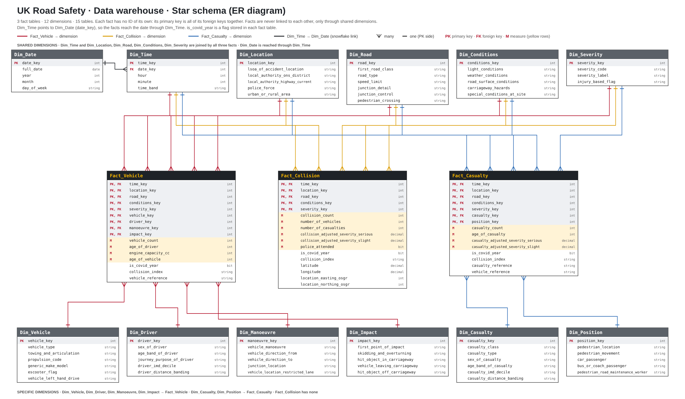

# UK Road Safety Data Warehouse (ETL-MASTER)

SQL Server staging and star-schema data warehouse for UK road safety collision, vehicle and casualty data (DfT open data), loaded with SSIS.



## Architecture

| Layer | Database | Contents |
|---|---|---|
| Source | CSV files | DfT collision, vehicle and casualty extracts (not included, see below) |
| Staging | `SA_RoadSafety` | `SA_Collision`, `SA_Vehicle`, `SA_Casualty`: typed copies of the CSVs |
| Warehouse | `DW_RoadSafety` | 12 dimensions and 3 facts (star schema) |

**Facts**

- `Fact_Collision`: one row per collision.
- `Fact_Vehicle`: one row per combination of the nine dimension keys, with `vehicle_count` and aggregated measures.
- `Fact_Casualty`: one row per casualty.

**Dimensions**: `Dim_Date`, `Dim_Time`, `Dim_Location`, `Dim_Road`, `Dim_Conditions`, `Dim_Severity`, `Dim_Vehicle`, `Dim_Driver`, `Dim_Manoeuvre`, `Dim_Impact`, `Dim_Casualty`, `Dim_Position`.

Dimensions use identity surrogate keys (`IDENTITY(1,1)`). Each fact's primary key is the set of its foreign keys.

## Repository layout

```
FROM_SCRATCH/
├── README.txt                 course-folder quick start
├── SRC/                       course material
└── ETL-MASTER/
    ├── ETL-MASTER.sln         Visual Studio solution
    ├── SQL-KIT/
    │   ├── SA.sql             creates SA_RoadSafety
    │   └── DW.sql             creates DW_RoadSafety and all warehouse tables
    ├── SRC/image.png          data warehouse model
    ├── SA_Load.dtsx           CSV -> staging
    ├── samp_2019.dtsx         optional: keep 2019 collisions only
    ├── Sample.dtsx            optional: sampling package
    ├── reset_dim.dtsx         truncates facts, clears dimensions, reseeds identities
    ├── DW_Load.dtsx           staging -> warehouse (12 dimensions, 3 facts)
    └── Master.dtsx            orchestrates the packages above
```

## Requirements

- SQL Server 2022 and SQL Server Management Studio (SSMS)
- Visual Studio 2022 with the SQL Server Integration Services extension
- Microsoft OLE DB Driver for SQL Server (MSOLEDBSQL)
- The DfT road safety CSV files (collision, vehicle, casualty) from the [DfT road safety data](https://www.gov.uk/government/collections/road-accidents-and-safety-statistics) page

## Setup

### 1. Create the databases

Run the scripts in SSMS, in this order, against your server:

1. `SQL-KIT/SA.sql`
2. `SQL-KIT/DW.sql`

If `CREATE DATABASE` fails with a file path error, replace the default `MSSQL16.MSSQLSERVER\MSSQL\DATA\` path in the script with your SQL Server data folder.

### 2. Point the project at your machine

Open `ETL-MASTER.sln` in Visual Studio, then:

1. In `SA_Load.dtsx`, set the file path of each flat file connection (`CM_CO`, `CM_VI`, `CM_CA`) to your CSV files.
2. In the Connection Managers pane, check `localhost.SA_RoadSafety` and `localhost.DW_RoadSafety`. If your server is not `localhost`, change `Data Source` in both.

## Running the ETL

### Full load

Run `Master.dtsx`. It executes the enabled packages in order:

`SA_Load` → `DW_Load`

Run `reset_dim.dtsx` before a reload, or let `Master.dtsx` call it, so the dimensions and identities start clean.

### Individual packages

| Step | Package | Purpose |
|---|---|---|
| 1 | `SA_Load.dtsx` | Loads the three CSVs into the staging tables. |
| 2 (optional) | `samp_2019.dtsx` | Keeps 2019 collisions in staging and removes orphaned vehicle and casualty rows. |
| 3 (before a reload) | `reset_dim.dtsx` | Truncates the three fact tables, deletes dimension rows, and reseeds identities. |
| 4 | `DW_Load.dtsx` | Loads the 12 dimensions, then `Fact_Collision`, `Fact_Vehicle` and `Fact_Casualty`. |

### Sampling switch

`Master.dtsx` contains the sampling packages as Execute Package Tasks. To run the full dataset, disable them; to run a smaller sample, enable them. Each task's *Disable* expression controls this, so you can switch without editing the packages.

### Loading order

Dimensions load before facts, and each fact looks up its dimensions. Fact tables must be truncated before dimensions are deleted, because the foreign keys block dimension deletes otherwise.

## Verifying the load

Run these in SSMS after `Master.dtsx` finishes.

```sql
-- Staging counts (depend on the CSVs and any sampling applied)
SELECT COUNT(*) AS collision_rows FROM SA_RoadSafety.dbo.SA_Collision;
SELECT COUNT(*) AS vehicle_rows   FROM SA_RoadSafety.dbo.SA_Vehicle;
SELECT COUNT(*) AS casualty_rows  FROM SA_RoadSafety.dbo.SA_Casualty;

-- Warehouse counts
USE DW_RoadSafety;
SELECT 'Fact_Collision' AS tbl, COUNT(*) AS n FROM dbo.Fact_Collision
UNION ALL SELECT 'Fact_Vehicle',  COUNT(*) FROM dbo.Fact_Vehicle
UNION ALL SELECT 'Fact_Casualty', COUNT(*) FROM dbo.Fact_Casualty;

-- Reconciliation: total vehicles in the fact should equal staging vehicle rows
SELECT SUM(vehicle_count) AS vehicles_in_fact FROM dbo.Fact_Vehicle;

-- Primary key uniqueness on Fact_Vehicle (should return no rows)
SELECT time_key, location_key, road_key, conditions_key, severity_key,
       vehicle_key, driver_key, manoeuvre_key, impact_key, COUNT(*) AS dupes
FROM dbo.Fact_Vehicle
GROUP BY time_key, location_key, road_key, conditions_key, severity_key,
         vehicle_key, driver_key, manoeuvre_key, impact_key
HAVING COUNT(*) > 1;
```

A load is complete when every fact row count matches its staging source after accounting for sampling, `vehicles_in_fact` matches the vehicle staging count, and the key query returns no rows.

## Design notes

- **Type safety.** Numeric source columns are cast in Derived Column steps with blank guards (`TRIM([col]) == "" ? NULL(DT_I4) : (DT_I4)[col]`), so empty CSV fields load as NULL instead of failing the package.
- **Identifiers kept as text.** `collision_index` contains letters in some years, so it's stored as a string, not an integer.
- **Dimension loading.** Dimensions use an add-only Lookup: rows already present are matched and rows not found are inserted. Re-running a dimension load is therefore safe.
- **Fact_Vehicle grain.** The fact's key is the nine dimension keys, so `collision_index` and `vehicle_reference` are kept as descriptive attributes only. Where several collisions share the same key combination, the attribute carries one arbitrary value from the group.

## Known limitations

- The CSV files are not included in the repository. Download them from the DfT site.
- Row counts from the warehouse may differ slightly from staging, because the load removes duplicate keys and orphaned rows. Use the reconciliation queries above to confirm the gap is expected.
